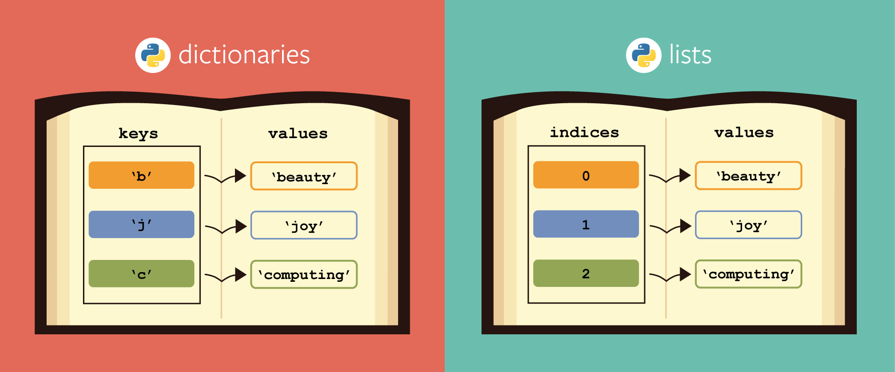
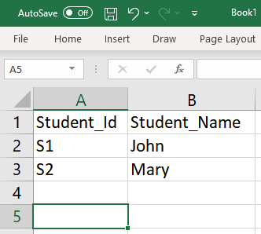
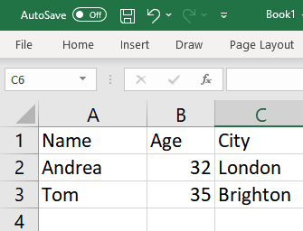

# 2-dimensional lists (and a critique)


---

## So far

:::: columns

::: {.column width="70%"}
While they admit arbitrary members, lists are best understood as iterables of homogeneous values
:::

::: {.column width="30%"}

:::

::::


---

## Nested lists

Represent multi-dimensional data

The meaning of data and the objective of the code guide the organization in lists and sublists

Example: weekend temperatures in Naples (from Thur. to Sun.)

```python
my2Dlist = [[18, 22, 20, 26], [26, 27, 28, 21], [18, 16, 21, 20]]
```

---

as with lists of strings, by simple nesting of indices we can access specific data points

Q: Temperature on the first Thursday of October?

. . .

```python
print(my2Dlist[0][0])
```
Visualise it on [Pythontutor](https://pythontutor.com/visualize.html#code=my2Dlist%20%3D%20%5B%5B18,%2022,%2020,%2026%5D,%20%5B26,%2027,%2028,%2021%5D,%20%5B18,%2016,%2021,%2020%5D%5D%0A%0A%23%20Q%3A%20Temperature%20on%20the%20first%20Thursday%20of%20October%3F%0A%0At%20%3D%20my2Dlist%5B0%5D%5B0%5D%0A%0Aprint%28t%29&curInstr=0&matrixMode=true&mode=display&origin=opt-frontend.js&py=311)

---

```{python}
my2Dlist = [[18, 22, 20, 26], [26, 27, 28, 21], [18, 16, 21, 20]]
```

Q: Average temperature on Thursday in October?

- use an accumulator variable

- go along the list, pick up the first item of each list 

- accumulate it

- print the computed average (if it exists: what if it's too early to tell?)


---

```{python}
accumulator = 0
count = 0

for weekend in my2Dlist:
  accumulator += weekend[0]
  count += 1

if count > 0:
  average_temp_thursday = accumulator / count
else: 
  # avoid 0 as it is a valid average temp.
  average_temp_thursday = NaN
```

Visualise it on [Pythontutor](https://pythontutor.com/visualize.html#code=my2Dlist%20%3D%20%5B%5B18,%2022,%2020,%2026%5D,%20%5B26,%2027,%2028,%2021%5D,%20%5B18,%2016,%2021,%2020%5D%5D%0A%0A%23%20Average%20temperature%20on%20Thursday%20in%20October%3F%0A%0Aaccumulator%20%3D%200%0Acount%20%3D%200%0A%0Afor%20weekend%20in%20my2Dlist%3A%0A%20%20accumulator%20%2B%3D%20weekend%5B0%5D%0A%20%20count%20%2B%3D%201%0A%0Aif%20count%20%3E%200%3A%0A%20%20average_temp_thursday%20%3D%20accumulator%20/%20count%0Aelse%3A%20%0A%20%20%23%20avoid%200%20as%20it%20is%20a%20valid%20average%20temp.%0A%20%20average_temp_thursday%20%3D%20NaN&curInstr=0&matrixMode=true&mode=display&origin=opt-frontend.js&py=311)

---

## Work with nested lists

Textual data sets may also be organized in 2-d lists

```python
my_writers = [
              ['Dickens', 1812],
              ['King', 1947],
              ['J.K. Rowling', 1965],
              ['Christie', 1890] 
] 

for row in my_writers:
      print(row)
```

Here a clear semantic structure remains *latent* within the Python variables


---

Print authors only:

```python
for row in my_writers:
  print(row[0])
```

Print authors and they their year of birth?

. . .

```python
for row in my_writers:
  for element in row:
      print(element)
```

Spin it up on [Pythontutor](https://pythontutor.com/visualize.html#code=my_writers%20%3D%20%5B%0A%20%20%20%20%20%20%20%20%20%20%20%20%20%20%5B'Dickens',%201812%5D,%0A%20%20%20%20%20%20%20%20%20%20%20%20%20%20%5B'King',%201947%5D,%0A%20%20%20%20%20%20%20%20%20%20%20%20%20%20%5B'J.K.%20Rowling',%201965%5D,%0A%20%20%20%20%20%20%20%20%20%20%20%20%20%20%5B'Christie',%201890%5D%20%0A%5D%20%0A%0Afor%20row%20in%20my_writers%3A%0A%20%20%20%20%20%20print%28row%29%0A%0Afor%20row%20in%20my_writers%3A%0A%20%20print%28row%5B0%5D%29%0A%0Afor%20row%20in%20my_writers%3A%0A%20%20for%20element%20in%20row%3A%0A%20%20%20%20%20%20print%28element%29%0A%0A&curInstr=0&matrixMode=true&mode=display&origin=opt-frontend.js&py=311)


---

## Observations

To extract the needed data we need to know something about their logical organization: the data structure

- each element is a weekend, starting Thursday

A fixed structure is required for instructions to work:

- each pair is author followed by year

A more flexible data structure is needed


# Dictionaries


---

## The non-list


:::: columns

::: {.column width="70%"}
An unsorted `bag` of values, each with its own label, called ``key``.

```python
my_data = {'author': 'Agatha Christie', 
            'nickname': 'Mary Westmacott', 
            'year_of_birth': 1890
          }
```
:::

::: {.column width="30%"}

:::

::::


---

## Properties

A dictionary is a collection of ``key:value`` pairs that is 

- unordered
- changeable, and
- indexed 

__Dictionaries are Python most powerful data structure__


---

## Extensibility

The more we have, the more we can put

```python
my_writers = [
  {'author':'Dickens', 'year_of_birth':1812},
  {'author':'King', 'year_of_birth':1947},
  {'author':'J.K. Rowling', 'year_of_birth':1965},
  {'author':'Agatha Christie', 'nickname':'Mary Westmacott', 'year_of_birth':1890}
]
```


---

## Accessing items

```python
my_dict = {'author': 'Agatha Christie', 
          'nickname': 'Mary Westmacott', 
          'year_of_birth': 1890
}

print(my_dict['author'])
```

. . . 

```python
NOW = 2024

delta = NOW - my_dict['year_of_birth']

print(f{{my_dict['author']} was born {delta} years ago.})
```


---

## Amending values

```python
my_dict['year_of_birth'] = 2019

print(my_dict['year_of_birth'])
```

. . .

```python
#
king = my_writers[1]

print(king['author'])

king['author'] = 'Stephen King'
```

We have more information but `my_writers` is unchanged

---

## Combining indices

```python
my_writers[1]['author'] = 'Stephen King'

print(my_writers)

[{'author':'Dickens', 'year_of_birth':1812}, 
 {'author':'Stephen King', 'year_of_birth':1947}, 
 {'author':'J.K. Rowling', 'year_of_birth':1965}, 
 {'author':'Agatha Christie', 'nickname':'Mary Westmacott', 'year_of_birth':1890}]
```


---

## Iteration

As the data structure is completely arbitrary, simple indexing (``i=0,1, ...``) does not work anymore.

A lazy iterable, similar to ``range``, will serve the ``key:value`` pairs on request

. . .

```python
# always key first
for key, value in my_dict.items():
  print(key, value) 
```

```text
author Agatha Christie 
nickname Mary Westmacott 
year_of_birth 1890
```

---

## The ``key`` and ``value`` variable names

```python
for key in my_dict.items():
  print(key) 
```

```text
author
nickname
year_of_birth
```

. . .

```python
for value in my_dict.items():
  print(key) 
```

```text
Agatha Christie 
Mary Westmacott 
1890
```

# Lists vs Dictionaries




---

## Grow a list

```python
my_list = []

my_list.append(10)

my_list.append(20)

print(alist)

[10, 20]
```

Direct access is always possible:

```python
print(my_list[-1])

20
```


---

## Grow a dictionary

```python
my_dict = {}

my_dict['name'] = 'Tom'

my_dict['age'] = 35

print(my_dict)
```

```text
{'name':'Tom', 'age':35}
```

```python
print(my_dict['name'])

Tom
```

Disadvantage: dictionaries are inherently unordered


---

## one key, many values



```python
my_python = {'Student_ID':['S1','S2'], 
            'Student_Name':['John', 'Mary']
}
```


---

## Recap: common operations

```python
# create an empty dictionary
my_dict = {}

# create a new dict with 3 items
my_dict = {'one':1, 'two':2, 'three':3}

# access an element
print(my_dict['two'])
```

Data updates:

```python
# add an entry
my_dict['four'] = 4

# change an entry
my_dict['one'] = 'uno'

# count items
howmany = len(my_dict)
```


---

## ``keys`` and ``values``


```python
# iterate over keys
for item in my_dict.keys():
  print (item)

# iterate over values
for item in my_dict.values():
  print(item)
```

Inspect the data structure:

```python
# list out the keys
my_dict.keys()

# list out the values
my_dict.values()
```

# Quiz!

---

:::: columns

::: {.column width="80%"}
Create a dictionary out of the following data:



Spin up VS Code and create a quick notebook
:::

::: {.column width="20%"}

:::

::::


