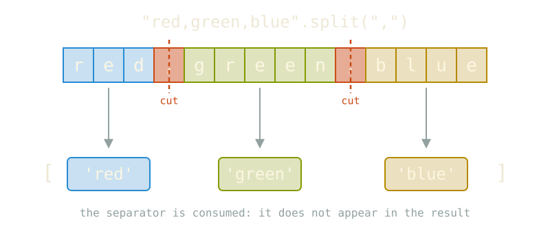

# String Methods

---

## Why split?

Real data rarely arrives in the shape we need

- a log line: `"2026-10-29 ERROR disk full"`
- a CSV row: `"Milan,1.4,Italy"`
- a chat message: `"ciao a tutti, buona giornata"`
- a file path: `"data/raw/channel_01.json"`

::: {.fragment}
Splitting turns **one string** into **a list of pieces** we can count, filter and analyse.
:::

::: notes
Link to text analysis: tokenising a message is the first step of almost every NLP pipeline.
:::

---

## A review of methods

Python variables (later, *objects*) come with built-in functions attached.

```{python}
mylist = []
```

now `variable_name.method_name(parameters)` works

. . .

```{python}
mylist.append('the first')
mylist.append('the second')
mylist.append('and the third')

l = len(mylist)

print(mylist[2:])
```


# Splitting methods

---

## `mystring.split()`

```{python}
mytext = "To be or not to be"

mywords = mytext.split()

print(mywords)
```

- `split()` returns a **list of strings**

- by default, we split on white spaces

- the original string is **not modified** (strings are immutable)


White spaces are gone!

---

```{python}
mytext = '''Two households, both alike in dignity,
          In fair Verona, where we lay our scene,'''

mywords = mytext.split(',')

print(mywords)
```

Commas are gone

---

## String slicing

{width="80%" fig-align="center"}

separators are cut out

---

### punctuation and line breaks

```{python}
mytext = '''Two households, both alike in dignity,
          In fair Verona, where we lay our scene,'''

mywords = mytext.split()

print(mywords)
```

---

## Parameters for `.split()`

```python
mytext.split(sep=None, maxsplit=-1)
```

| parameter  | meaning                 | default            |
|------------|-------------------------|--------------------|
| `sep`      | the delimiter to cut on | `None` (whitespace)|
| `maxsplit` | maximum number of cuts  | `-1` (no limit)    |

---

## Giving a separator

```{python}
myrowofdata = "Milan,1.4,Italy"

myrowofdata.split(',')
```

. . .

```{python}
myrowofdata = "Milan,1.4,Italy"

myrowofdata.split(sep=',')
```

---

Find the `.doc` file and make it a `.docx` file

```{python}
myfilepath = 'C:/Users/aless/Downloads/_git/learn_code/58-string-methods/myfile.doc'
```

. . .


```{python}
the_pieces = myfilepath.split('/')

print(the_pieces)
```


---

the file name is the last element of the path

```{python}
the_file_name = the_pieces[-1]

print(the_file_name)
```

. . .

chop off the `.doc` and replace it 

```{python}
two_pieces = the_file_name.split('.')

print(two_pieces)
```

. . .

```{python}
new_name = two_pieces[0] + '.docx'

print(new_name)
```

. . .

```{python}
new_file = the_pieces.pop() + new_name

print(new_file)
```

what happened to the `/`s?


# Join, the anti-split

---

## The `.join` method

Dual to `.split`, with a funny syntax


```{python}
prep_list = ['the first', 'the second', 'and the third']

mystring = ''.join(prep_list)

print(mystring)
```

. . . 

```{python}
prep_list = ['the first', 'the second', 'and the third']

# comma followed by a whitespace
mystring = ', '.join(prep_list)

print(mystring)
```

---

## Joining is the inverse

```{python}
words = ["to", "be", "or", "not", "to", "be"]

myphrase = " ".join(words)
print(myphrase)
```

. . . 

```python
test = 'a,b,c'

recontructed = ','.join(s.split(",")) 

print (reconstructed)
```


# For reference: splitting in Pandas

---

## Pandas dataframes

```python
import pandas as pd

df = pd.DataFrame({"channel": ["it_news/2026", "it_sport/2025"]})

df[["name", "year"]] = df["channel"].str.split("/", expand=True)
```

| channel        | name     | year |
|----------------|----------|------|
| it_news/2026   | it_news  | 2026 |
| it_sport/2025  | it_sport | 2025 |

`expand=True` turns the pieces into **columns**.

---

## Splitting lists, instead

Slice a **list** into chunks of size `n`:

```{python}
data = list(range(10))
n = 4

chunks = [data[i:i + n] for i in range(0, len(data), n)]
```


---

## Summary

- `split` goes from text to list, `join` does the opposite

- `split(" ")` and `split()` behave differently
- `split` does not change the original string
- deploy `strip()` when lines carry trailing spaces or newlines
- [for CSV files use specific line parsers in `csv` or `pandas`]
