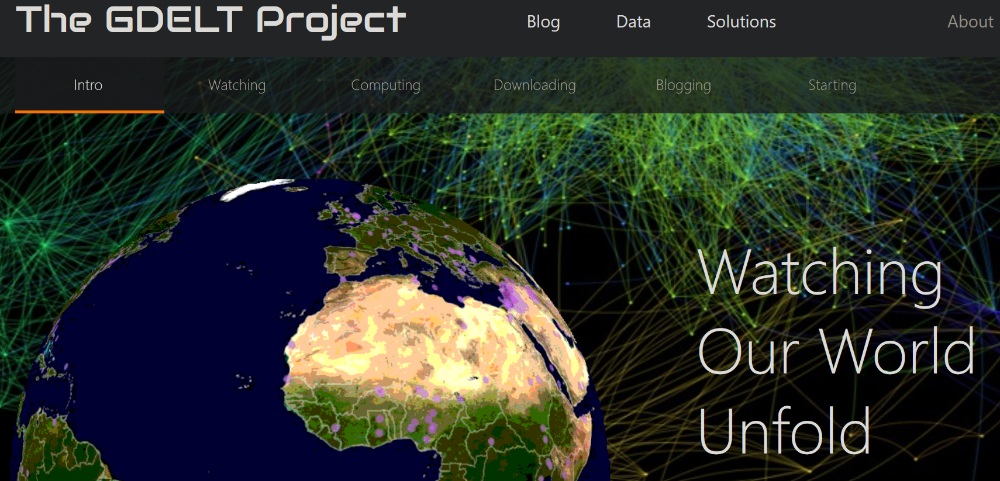

# APIs in Python

---

## Objectives

Via the Python `wget` module we can obtain data from the web

Good for updates and for proving provenance 

. . .

it requires to know the exact position of the data file


all-or-nothing behaviour: 

- download everything from scratch again

- download the whole file, select the needed data later

---

## API: the idea

ask the web site/data server to serve an ad hoc file containing strictly the data we need

data is assigned directly to a file (CSV, JSON) so we can read it later

. . .

If connection breaks, or our request is too selective, the returned file could be empty

---

## Example

10 recent (3 months) articles on migration from `gdeltproject.org`

Try this on your browser:

[api.gdeltproject.org/api/v2/doc/doc?query=migration&mode=ArtList&maxrecords=10&format=json](https://api.gdeltproject.org/api/v2/doc/doc?query=migration&mode=ArtList&maxrecords=10&format=json){target="_blank"}
gdeltpro


---

## API needs modules

```{python}
import os
import urllib.request
import wget
```

. . .

GDELT may refuse the default Python User-Agent

```{python}
opener = urllib.request.build_opener()
opener.addheaders = [("User-Agent", "Mozilla/5.0")]
urllib.request.install_opener(opener)
```

---

```{python}

filename = "migration.json"

# wget would otherwise save a second copy as "migration (1).json"
if os.path.exists(filename):
    os.remove(filename)
```

. . .

```python
url = ("https://api.gdeltproject.org/api/v2/doc/doc"
       "?query=migration&mode=ArtList&maxrecords=10&format=json")

wget.download(url, out=filename)

print()  # wget's progress bar does not end the line
print(filename, os.path.getsize(filename), "bytes")
```

`out=` fixes the name of the local file

`os.path.getsize` verifies that the file is not empty


# The GDELT Project

---

## *Global Database of Events, Language and Tone*

- Monitors print, broadcast and web news from around the world, in over 100 languages
- Open data, free and updated continuously
- The DOC 2.0 API searches a rolling window of the most recent three months of news coverage; no registration or API key is required

{fig-alt="Screenshot of the GDELT Project home page" width="90%"}


# API basics

## Definition

[Application Programming Interface (API)](https://en.wikipedia.org/wiki/API)


a defined menu of requests that our *client* may make to a *server,* together with the form of the responses.

{fig-alt="Client and server" width="80%" fig-align="center"}

The client never accesses the database directly; it uses only the operations that the API exposes.

## Web APIs and HTTP

Web APIs use the **Hypertext Transfer Protocol (HTTP)**: the client sends a request to a URL, and the server returns a response with a status code and a body.

{fig-alt="HTTP request and response" width="70%" fig-align="center"}

[HTTP (Wik)](https://en.wikipedia.org/wiki/HTTP) 
[HTTP status codes (Wik)](https://en.wikipedia.org/wiki/List_of_HTTP_status_codes)

## Anatomy of a request URL

```
https://api.gdeltproject.org/api/v2/doc/doc?query=migration&mode=ArtList&format=json
```

{fig-alt="Anatomy of a request URL" width="75%" fig-align="center"}

Parameters are written as `name=value` pairs separated by `&`.

Try this out on your browser to check *liveness:* use `http` as plan b.


[URL (Wiki)](https://en.wikipedia.org/wiki/URL) 

[Query string (Wiki)](https://en.wikipedia.org/wiki/Query_string)

---

## Request parameters

| Parameter | Meaning | Example |
|---|---|---|
| `query` | search terms/filters | `"migration" sourcelang:english` |
| `mode` | type of output | `ArtList`, `TimelineVol` |
| `maxrecords` | no. of articles (max 250) | `50` |
| `timespan` | look-back window | `1d`, `1week`, `3months` |
| `format` | output format | `json` |


---

## What could be possibly go wrong?

well, a lot.




# JSON reminder

## JavaScript Object Notation

JSON is a lightweight text format for structured data. Its structure maps directly onto Python types.

| JSON | Python |
|---|---|
| object `{ }` | `dict` |
| array `[ ]` | `list` |
| string | `str` |
| number | `int` or `float` |
| `true`, `false`, `null` | `True`, `False`, `None` |


[JSON (Wiki)](https://en.wikipedia.org/wiki/JSON)

## Reading JSON in Python

```python
import json

with open("migration.json") as f:
    data = json.load(f)

print(type(data))              # <class 'dict'>
print(list(data.keys()))       # ['articles']
print(len(data["articles"]))   # number of articles returned
print(data["articles"][0])     # the first article, a dict
```

---

JSON is a Python list of dictionaries on wheels...


```json
{
  "articles": [
    {
      "url": "https://spectator.com/article/the-return-of-migration-centrism/",
      "url_mobile": "",
      "title": "Small boat crossings: what the quarterly figures show",
      "seendate": "20251117T093000Z",
      "socialimage": "",
      "domain": "spectator.com",
      "language": "English",
      "sourcecountry": "United Kingdom"
    },
    {
      "url": "https://spectator.com/article/frances-migration-hypocrisy/",
      "url_mobile": "",
      "title": "France’s migration hypocrisy",
      "seendate": "20260410T093000Z",
      "socialimage": "",
      "domain": "spectator.com",
      "language": "English",
      "sourcecountry": "United Kingdom"
    },
  ]
}
```