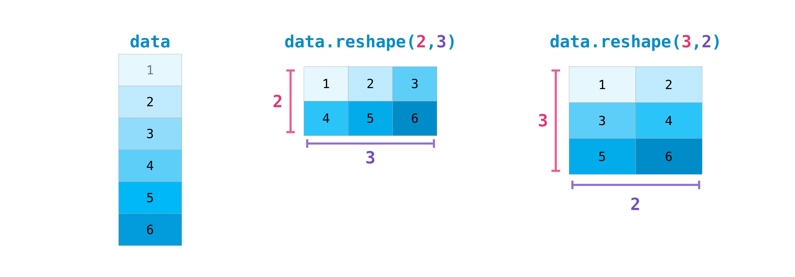
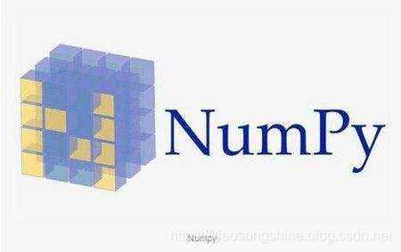

#


---

## Motivations

Python does not cover the data structures normally used in science/engineering.

Numpy comes in to support data manipulation of n-dimensional arrays.

Extensive library of functions to reshape data.

Comprehensive collection of mathematical operations. 

```bash
pip install numpy
```

See [numpy.org/](https://numpy.org/){target="_blank"} for a comprehensive introduction

---

## Arrays

The computer version of vectors and matrices from Maths

a sequence of uniform-type values, indexed by integers.

```{python}
import numpy as np
```

```{python}
# the sequence of integers, from 2 to 20 (excl.) with step 2

b = np.arange(2, 18, 2)

b
```

---

Numpy arrays have methods and functions that computed element-wise:
```{python}
# element-wise operations
2*b
```

```{python}
# cumulative step-by-step sum
b.cumsum()
```

---

## Lists vs. Arrays

A list is a generic sequence of heterogenous objects.

So, strings, numbers, characters, file name, URLs can be all mixed up!

```python
mylist[0]

mylistoflists[0][1]
```

An array is a sequence of strictly-homogenous objects, normally `int` or `float`

Same indexing notation as lists:

```python
my_array[1]

my_matrix[1][3]
```

---

```{python}
# a regular list
a = [3.14, 3.15, 3.16, 3.17, 3.18]

# a NumPy array
b = np.array([3.14, 3.15, 3.16, 3.17, 3.18])

2*b
```


```{python}
2*a
```

. . .

```{python}
a+a
```

. . .

```{python}
b+b
```

. . .

```{python}
a+b
```

---

## Notation

1-dimension: an array (sequence of numbers): `[1, 23, …]`

2-dimensions: a matrix (table of numbers) `[ [1, 23, …], [14, 96, …], ...]`

3-dimensions: a *tensor* (box/cube/cuboid) of numbers:  `[ [ [1, 23, …], [14, 96, …], …], ...]`

---

## 2-D Numpy Arrays

```{python}
c = np.arange(8)

c
```

```{python}
# build a 2-dimensional array from a 1-d one
d = np.array([c, c*2])

d
```

```{python}
# count elements

d.size
```


```{python}
#  size along each dimension

d.shape
```

---

## Axes

Arrays can have more than 2 dimensions

Each is called *axis*


```{python}
# operations along columns
d
```

```{python}
# operations along columns
d.sum(axis=0)
```

---

```{python}
# summing by row
d.sum(axis=1)
```


__N. B.__ unlike Pandas, not specifying the axis will apply a function to the entire array.

```{python}
# sum the whole content
d.sum()
```

---

## Shapes

Using information about the shape we can create/manipulate (or reshape, or transpose) Numpy variables.

```{python}
# Create 2x3 Numpy array and initialise it to 0s
e = np.zeros((2, 3), dtype = 'i')

e
```

```{python}
# Change the shape
e.reshape(3, 2)
```

-----

```{python}
data = np.array([1, 2, 3, 4, 5, 6])
```



-----

## Keeping shapes uniform

Array operations are defined only between objects of the same shape

```{python}
# a new array with exactly the same shape as 'e' and type integer
f = np.ones_like(e, dtype = 'i')
f
```


---


```{python}
# Transposition
g = np.arange(6).reshape(3,2)
g
```


```{python}
g.T
```
---

## Stacking

2-D arrays with the same dimensions can be merged 

```{python}
# Create an identity matrix of order 5
i = np.eye(5)

i
```

---

```{python}
# stacking combines two 2-d arrays: vertically
np.vstack((i, i))
```

-----

```{python}
# stacking combines two 2-d arrays: horizontally
np.hstack((i, i))
```


# N-dimensional arrays

---

## Motivations

Physics/Engineering often uses 4-dimensional tensors: 3 space coordinates + time

Numpy can handle multiple dimensions.

This is useful when dealing with multivariate data, from time series to documents.

---

Example: collect `N` interviews, there are 2 questions and for each there is a score from the respondent and a score from the interviewer:

```{python}
# N-dimensional array
import numpy as np
N = 4

g = np.zeros((2, 2, N), dtype='i')

g
```

---

## Slicing by Boolean filters

Select data according to specific conditions

A Boolean filter can winnow the array according to a yes/no, in/out condition

a Boolean filter can be represented by a Numpy array!

```{python}
# setup data
l = np.array(np.arange(9))

l
```

---

## More slicing

```{python}
# Let's apply a high-pass filter

l[l>4]
```

```{python}
# Generate a Boolean array

(l>4)
```

```{python}
# now with integers: False=0, True=1)

(l>4).astype(int)
```

---



